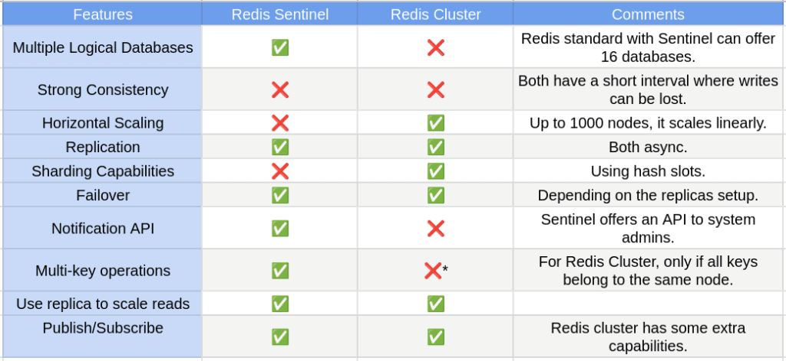

# SQL

## [Delete AND Truncate](#delete-vs-truncate)
## [Isolation level](#isolation)
## [mysql vs postgres](#mysql-postgresql)
## [Execution order document](#execution-order)
## [Index document](#index)
## [Partition document](#partition)
## [Sharding document](#sharding)

# NOSQL
## [Redis document](#redis)
### [Redis backup document](#redis-backup)

# Message brokers
## [kafka vs rabbitmq](#kafka-rabbitmq)


# SQL vs Nosql
- ACID is a set of properties of relational database transactions.

    Atomicity - Each transaction is all or nothing( ví dụ giao dịch rút từ a chuyển đến b thì bắt buộc phải hoàn tất hoặc phải rollback)
    Consistency - Any transaction will bring the database from one valid state to another (ví dụ: nếu bản quản lí số lượng hàng, và số lượng hàng không bao giờ là âm, thì một giao dịch không được vi phạm quy tắc này)
    Isolation - Executing transactions concurrently has the same results as if the transactions were executed serially
    Durability - Once a transaction has been committed, it will remain so

- When to Choose SQL:
    - Structured Data
    - Complex Queries
    - ACID Compliance:  If your application needs strong consistency and reliability (e.g., banking systems), an SQL database is a good choice.
- When to Choose NoSQL
    - Unstructured or Semi-Structured Data
    - Scalability: NoSQL databases are designed for horizontal scaling, which means you can easily add more servers to handle increased load


# mysql postgresql
- Mysql write better than postgress
- MVCC
  - MySQL: InnoDB’s MVCC tends to perform better in write-heavy applications 
  due to its separation of old row versions into undo logs, 
  reducing main table size and avoiding extensive bloat.
  MySQL is therefore better suited to workloads with 
  high concurrency and frequent updates, 
  as undo logs can be cleaned efficiently.
  - PostgreSQL: MVCC can lead to table bloat in PostgreSQL 
  as each update creates a new row version in the main table. 
  Although autovacuum helps manage this, 
  write-heavy workloads may suffer due to the additional overhead 
  and delays from cleaning up dead tuples. PostgreSQL’s approach can 
  also increase I/O for high-throughput writes.


- postgres can analyze a complex query better than mysql. 
mysql is suitable with a simple query


# Delete Vs Truncate
## DELETE
    - For every row deleted, the database records the DELETE operation, 
    which can significantly increase I/O operations and slow down performance, 
    especially for large tables.
    - Maintains undo logs to support rollback, adding additional overhead.
    - Can leave the table fragmented, especially if many rows are deleted, as it does not reclaim space at the page level. May require additional maintenance (e.g., rebuilding indexes or defragmentation) to optimize table performance afterward.
## TRUNCATE
    - Minimally logs the operation by deallocating entire data pages at once, not individual rows.
    - Much faster for large datasets as it avoids row-by-row logging.
    - Reclaims all space allocated to the table and its indexes by resetting the table's structure. Leaves the table in a clean and defragmented state, ready for new data.

# Isolation

- Read Uncommitted:

Allows dirty reads. A transaction can read data that has been modified but not yet committed by other transactions.
Pros: Highest performance and concurrency.
Cons: Least consistency; data may be invalid.

- Read Committed (Postgresql):

A transaction can only read data that has been committed by other transactions.
Pros: Prevents dirty reads.
Cons: Non-repeatable reads can occur (data may change between reads within the same transaction).

- Repeatable Read: (Mysql) tưởng tượng giống như m đọc 1 transaction trong mysql và query lại bao lần thì nó cũng v

Ensures that if a transaction reads a row, it can read that row again and get the same values,
 even if other transactions are modifying the data.
Pros: Prevents dirty reads and non-repeatable reads.
Cons: Phantom reads can occur (new rows added by other transactions can be seen in subsequent queries).

- Serializable:


It ensures complete isolation from other transactions by making them appear as if they are executed sequentially.
Pros: Prevents dirty reads, non-repeatable reads, and phantom reads.
Cons: Lowest performance and concurrency; can lead to increased blocking and deadlocks.
============
## Read Lock (Shared Lock)
- Purpose: Allows multiple transactions to read (or select) data simultaneously.
- Behavior:
    - Multiple transactions can acquire a read lock on the same data.
    - No transaction can modify (write) the data while there are active read locks.
    
- Example: If Transaction A reads a row with a read lock, Transaction B can also read that row but cannot modify it until Transaction A releases the lock.
## Write Lock (Exclusive Lock)
- Purpose: Allows a transaction to modify (write) data.
- Behavior:
    - Only one transaction can hold a write lock on a specific piece of data at a time.
    - While a write lock is held, no other transaction can read or write that data.
- Example: If Transaction A acquires a write lock on a row, no other transaction can read or modify that row until Transaction A completes its operation and releases the lock.
## Update Lock
- Purpose: Used to prevent deadlocks while allowing transactions to read data.
- Behavior:
    - Allows a transaction to read a row and indicates that it intends to modify it.
    - Other transactions can still acquire read locks but cannot acquire exclusive locks on the same row.
Example: A transaction places an update lock on a row when it intends to update it after reading.
===========

- Optimistic locking doesn’t lock rows when reading. It uses a version field and checks it during updates. If the version changed, the update fails and the app retries. It doesn’t create deadlocks because no row-level locks are held.

- Pessimistic locking locks the row immediately when it’s read (e.g., SELECT FOR UPDATE). It prevents concurrent writes but can cause deadlocks if transactions lock resources in different orders.
- Deadlock handling:
Use a consistent lock order, keep transactions short, or switch to optimistic locking and retry on conflicts.
===========

## Execution order
Basic SQL Execution Order:
SQL queries are executed in the following order:

    FROM: Determine the source of the data.
    WHERE: Filter the rows that match the condition.
    GROUP BY: Group rows into summary rows.
    HAVING: Filter the grouped rows.
    SELECT: Specify the columns to retrieve.
    DISTINCT: Remove duplicate rows from the result.
    ORDER BY: Sort the result set.
    LIMIT / OFFSET: Specify the number of rows to return or the starting point.


## Index
- Partial Index(Postgresql)
An index built only on a subset of the table, based on a condition. This can save space and improve performance for queries that commonly filter on that condition.

Example:

```
CREATE INDEX idx_active_employees ON employees (name) WHERE status = 'active';
```

- Hash Index: Although not supported by InnoDB, certain storage engines in MySQL, such as MEMORY and NDB (NDBCluster), support hash indexes. Hash indexes are efficient for exact match lookups but not suitable for range queries or sorting.
- Composite Index (Multi-Column Index): Composite indexes are indexes created on multiple columns. They can improve query performance for queries that involve conditions on multiple columns by allowing the database to perform index range scans or index merges.
- Full-Text Index: Full-text indexes are special indexes used for full-text search operations. They are designed to efficiently search for words or phrases within large blocks of text data stored in TEXT or VARCHAR columns.

- B-tree Index:  
    + B-trees are balanced, meaning that the depth of the tree remains relatively constant even as the number of entries increases. This ensures that search operations have a consistent time complexity, typically O(log n) where n is the number of entries.
    + Support for Range Queries: B-tree indexes are particularly efficient for range queries, where you need to retrieve data within a specified range of values.
    + Sorted Order: Within each node of the B-tree, keys are stored in sorted order, allowing for efficient range scans and range-based queries.
    + Support for Range Queries: B-tree indexes are particular.


# Partition
MySQL supports several types of partitioning methods, each with its own characteristics and use cases. Here are the main types of partitioning supported by MySQL:

- Range Partitioning: With range partitioning, rows are distributed across partitions based on the range of values in a specified partitioning key column. For example, you could partition a table of sales data based on the sales date, with each partition representing a specific time period (e.g., monthly or yearly partitions).

```
CREATE TABLE table_name (
    column1 datatype,
    column2 datatype,
    ...
) PARTITION BY RANGE (column_name) (
    PARTITION partition_name1 VALUES LESS THAN (value1),
    PARTITION partition_name2 VALUES LESS THAN (value2),
    ...
    PARTITION partition_nameN VALUES LESS THAN MAXVALUE
);
```

- List Partitioning: List partitioning allows you to explicitly define which rows belong to each partition based on discrete values in a partitioning key column. For instance, you could partition a table of customer data based on the country or region of each customer.

```
CREATE TABLE products (
    id INT NOT NULL,
    product_name VARCHAR(100),
    category_id INT NOT NULL
) PARTITION BY LIST (category_id) (
    PARTITION p_electronics VALUES IN (1, 2, 3),   -- Điện tử
    PARTITION p_clothing VALUES IN (4, 5, 6),      -- Quần áo
    PARTITION p_food VALUES IN (7, 8, 9),          -- Thực phẩm
    PARTITION p_other VALUES IN (DEFAULT)          -- Các loại khác
);
```

- Hash Partitioning: Hash partitioning distributes rows across partitions based on a hash function applied to one or more columns. This method can help evenly distribute data across partitions, which can be useful for load balancing and preventing hotspots.
```
CREATE TABLE users (
    id INT NOT NULL,
    name VARCHAR(50),
    email VARCHAR(100)
) PARTITION BY HASH (id) (1 cột duy nhất)
PARTITIONS 4;
```
- Key Partitioning: Key partitioning is similar to hash partitioning but uses a hash function applied to the columns used in the table's primary key or unique key. This method is suitable for tables with unique keys that are not sequential.
```
CREATE TABLE orders (
    order_id INT NOT NULL,
    customer_id INT NOT NULL,
    order_date DATE NOT NULL,
    total_amount DECIMAL(10, 2)
) PARTITION BY KEY (customer_id, YEAR(order_date))
PARTITIONS 6;
```
- Composite Partitioning: Composite partitioning allows you to use a combination of partitioning methods, such as range-hash or range-list partitioning. 
This can provide more flexibility in partitioning large tables.

# Sharding
- Range-Based Sharding
- Hash-Based Sharding
- Directory-Based Sharding
- Geo sharding

# Redis
- Redis is an in-memory key-value store that’s used as a database, cache, and message broker. It provide high speed and flexibility, making it ideal for applications that need quick data retrieval and high performance.
- Rich Data Structures: Redis supports multiple data types such as:
    - Strings: Simple text or binary data.
    - Lists: Ordered collections (like queues).
    - Sets: Unordered unique items.
    - Hashes: Maps of key-value pairs (useful for objects).
    - Sorted Sets: Similar to sets but with scores for ordering (useful for leaderboards).
    - Bitmaps, HyperLogLogs, Streams: Specialized structures for advanced use cases.
- Pub/Sub messaging: Allows real-time communication by sending messages to multiple subscribers.

Advantages:
    - Fast: Redis is extremely fast due to its in-memory storage, handling millions of operations per second.
    - Scalable: Redis supports clustering, enabling horizontal scaling for high availability and distributed workloads.
    - Simple to Use: Redis is easy to set up and integrates well with various programming languages.
Disadvantages:
    - Memory-Intensive: Redis stores data in RAM, which means it can be costly for large datasets, as the memory must be scaled accordingly.
    - Single-threaded: Redis is single-threaded for command processing, which can be a bottleneck in CPU-bound workloads, although it handles high I/O operations well.

- token bucket: tạo token mỗi phút rồi mỗi request lấy 1 cái
- leaky bucket: giống queue sẽ chạy đều đều

## Sentinel vs Cluster
# 
## Redis Hashing
Redis Cluster distributes keys across multiple nodes using a technique called consistent hashing. Here's a simplified explanation of how it works:

- Hashing Keys: Each key that you insert into a Redis Cluster is hashed using a hash function. Redis uses CRC16 to hash keys by default.

- Determining Slots: The hash value produced by hashing the key is mapped to one of 16,384 hash slots (0-16383). These hash slots represent the entire keyspace in Redis Cluster.

- Assigning Slots to Nodes: Each Redis Cluster node is responsible for a subset of these hash slots. When a node joins the cluster or when the cluster is initialized, the hash slots are evenly distributed across the available nodes. Each node is assigned a range of hash slots to handle.

- Routing Keys: When a client sends a command to a Redis Cluster node, the node calculates the hash slot for the key involved in the command. Based on the hash slot, the node determines which other node in the cluster is responsible for that hash slot.

- Redirecting Commands: If the receiving node is not the owner of the hash slot for the key, it replies to the client with a redirection message containing the address of the correct node that owns the hash slot. The client then directly connects to the correct node to complete the operation.

- Data Distribution: Keys are distributed across nodes in a way that aims for a balanced distribution of hash slots across the cluster. This helps ensure that the load is evenly distributed and that each node has a roughly equal number of hash slots assigned to it.

By using consistent hashing and distributing hash slots among nodes, Redis Cluster achieves scalability, fault tolerance, and load balancing. It allows for horizontal scaling by adding or removing nodes dynamically while maintaining data consistency and availability.

## Redis Backup
- AOF Persistence: With AOF enabled, Redis logs every write operation to an append-only file on disk. This ensures that every change made to the dataset is recorded in the AOF file.

- RDB Persistence: In addition to AOF, Redis can also periodically create point-in-time snapshots of the dataset using RDB. These snapshots capture the entire dataset at a specific moment in time and save it to a binary dump file on disk.

- Benefits
    + Durability: AOF ensures that every write operation is persisted to disk before being executed in memory, providing durability in case of system failures or crashes.
    + Fast Recovery: In the event of a crash or restart, Redis can use the AOF log to recover the dataset by replaying the logged commands. While AOF-based recovery may be slower than RDB, it provides more granular data recovery.
    + Fast Startup: The periodic RDB snapshots provide a fast and efficient way to restore the dataset during Redis startup, as loading data from an RDB snapshot is generally faster than replaying the entire AOF log.
    + Reduced Risk: Using both AOF and RDB together reduces the risk of data loss by providing multiple points of recovery. If one persistence mechanism encounters issues, Redis can fall back to the other method for data restoration.

======


# Processes
## Concept
- A running instance of a program is called a process and it runs in its own memory space. Each time you execute a command, a new process starts. An active processs also includes the resources the program needs to run. These resources are are managed by the operating system(heap, process registers, program counters)
- Each process has its own memory adress space and one process cannot corrupt the memory space of another process. 

-  A process is an active entity as opposed to a program, which is considered to be a passive entity.
-  A new process is created only when running an executable file (not when running Shell builtin commands).
- Process properties:
    + PID (Process ID) - a unique positive integer number 
    + User
    + Group
    + Priority / Nice
- Type of Processes:
+ Parent
+ Child
+ Daemon
+ Zombie (defunct): a terminated child process that remains in the system's process table while waiting for its parent process to collect its exit status
+ Orphan: A process whose parent process no more exists i.e. either finished or terminated without waiting for its child process to terminate 
## Thread
- A Thread is a unit of execution within a process. A process has at least  one thread. It is called the main thread. 
- Each has it own stack and it is possible to communicate between threads using shared memory space. However, a misheaving thread can bring down the entire process
## How CPU run a thread or process on a CPU
- This is handled by context switching. When one process is switched out of the CPU so another process can run
- The operating system stores the state of the current running process so the process can be retored and resume execution at a later point
- In then restores the previously state of other process and resumes execution of that process.
- Context switching is really expensive. It involves saving and loading of registers, switching out memory of pages and updating various kernal data structures.
- Switching execution between threads also requires context switching but it's faster because there are few state to track and there is no need to switch out virtual memory pages which is one of the most expensive operations during a context switch.
- Some other mechanisms: fiber or coroutine
# Cron
## Anacron: 
# Mount disk


# Kafka rabbitmq 
## Apache Kafka
Kafka is a distributed event-streaming platform optimized for high throughput, durability, and scalability, log retention. It’s commonly used for real-time data processing and event-driven applications.

Pros:

- High throughput: Kafka’s design is optimized for handling large volumes of data with minimal latency.
- Durability: Messages are written to disk, ensuring data persistence even in the event of a failure.
- Scalability: Kafka’s partitioned log model allows it to scale horizontally across multiple servers, handling massive data loads.
- Stream processing: Kafka’s integration with tools like Kafka Streams and Apache Flink allows for real-time data processing.

Cons:

- Complex setup and maintenance: Kafka’s infrastructure requires more configuration and is harder to set up compared to simpler brokers like RabbitMQ.
- Higher resource requirements: Kafka needs substantial storage and memory, making it more demanding than lightweight solutions.
- Limited support for message acknowledgment: Kafka offers "at least once" and "at most once" delivery but lacks native support for "exactly once" delivery across distributed systems.

## RabbitMQ
RabbitMQ is a message broker that supports complex routing and message queueing, offering versatile options for message handling and delivery patterns.

Pros:

- Ease of use: RabbitMQ is relatively easy to install, configure, and manage, with a lower learning curve for new users.
- Flexible message routing: RabbitMQ supports complex routing using exchanges and queues, ideal for applications needing multiple routing patterns.
- Supports multiple protocols: RabbitMQ supports protocols like AMQP, MQTT, and STOMP, making it versatile for various integrations.
- Reliability: RabbitMQ has built-in support for message acknowledgments, making it easier to implement "exactly once" or "at least once" delivery.

Cons:

- Lower throughput than Kafka: RabbitMQ is not optimized for handling extremely high message rates or large message sizes.
- Scaling challenges: RabbitMQ can scale, but it typically requires extra configuration and does not scale as easily as Kafka.
- Less suited for log aggregation and event streaming: RabbitMQ is designed more for traditional message queueing rather than high-throughput event streaming.

- Example usecase:
  - For the placing an order feature, I choose Kafka over RabbitMQ because we need to keep a history of order events, which is essential for auditing order lifecycles or retry it again. In contrast, RabbitMQ removes messages immediately after receiving acknowledgments, making it less suitable for our needs. Another reason is that Kafka allows multiple consumers to form a consumer group, where each consumer processes different partitions of the same topic and one topic allow only one consumer. it may reduce the risk of double spending money, for example.

  - For simple job notifications or emails, I prefer RabbitMQ over Kafka because it supports complex routing patterns, making it easier to route messages to specific queues based on rules or criteria. RabbitMQ’s simplicity in setup and management makes it more straightforward to implement for these lighter, asynchronous tasks. Additionally, RabbitMQ is generally more resource-efficient for lower-throughput requirements, making it ideal for small jobs like notifications and emails.

# Push vs pull model  ======= 

## Push Model
In the push model, data is sent automatically from the producer to the consumer whenever an update is available.

- Advantages:

  - Low Latency: Data reaches consumers immediately, ideal for real-time applications where timely information is critical.
  -Less Polling Overhead: Since the producer pushes data, there’s no need for the consumer to constantly check for updates, reducing unnecessary network traffic.
  - Efficient for Small, Frequent Updates: Works well for scenarios with frequent, small updates, as data flows directly without delay.
- Disadvantages:

Backpressure Issues: If consumers can’t keep up with the data flow, they may become overwhelmed, leading to delays or data loss.
Lack of Control for Consumers: Consumers have little control over when and how much data they receive, which can be problematic for applications with limited resources.
Complex Error Handling: Handling failed deliveries or reconnection logic can be more complex, especially when pushing data to multiple consumers.

## Pull Model
In the pull model, consumers request data from the producer when they are ready.

- Advantages:

  - Consumer-Controlled: Consumers control when they receive data, making it easier to manage resources and avoid overload.
  - Better for Batch Processing: Consumers can pull data in batches, which is often more efficient for processing large amounts of data periodically.
  - Error Resilience: Failed requests can be retried by the consumer, and the consumer can manage error handling and reconnections more easily.

- Disadvantages:

  - Higher Latency: Data may not be received immediately since it depends on the consumer’s polling interval, which can lead to delays.
  - Increased Polling Overhead: Frequent polling can lead to unnecessary network traffic and increased load on the producer if the consumer checks too often.
