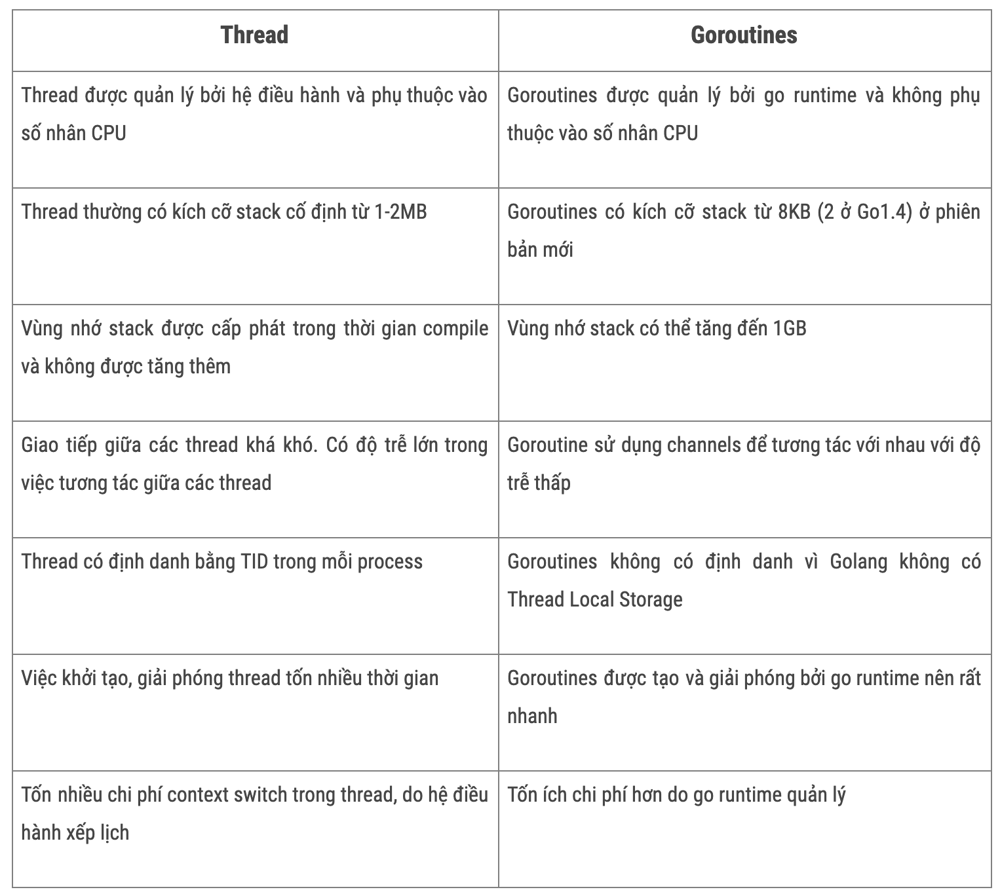

# Concurrency & Channels

## Channel Types
### unbuffered channel 
    An unbuffered channel does not have any capacity to store values. 
It requires both a sender and a receiver to be ready at the same time to 
complete the communication. A send operation will block 
until another goroutine is ready to receive, and vice versa.


- For example, I have a long-running task on the database. Running multiple tasks at once can cause an overload, so I can use a buffered channel to ensure that only one task can run at a time
### buffer channel 
    A buffered channel has a capacity that allows it to store a specified number of values. 
    The sender does not block until the buffer is full. 
    If the buffer is full, the sender will block until a value is received
    from the channel and space is freed up.
- pull message from queue,  i publish them to channel then all worker can pull message from that to execute

# Context
- The context package provides a way to propagate cancellation signals and deadlines across API boundaries and goroutines.
- It is primarily used to control the lifecycle of operations and to pass metadata (like values associated with requests) through the call stack.


# rest vs graph
## REST
- Overview:
Pros:
  - Simplicity: REST is straightforward to understand and implement, as it leverages existing HTTP methods and status codes.
  - Caching: Supports built-in caching mechanisms using HTTP headers, which can improve performance for certain types of requests.
  - Wide Adoption: REST is widely used and supported across many programming languages and frameworks, making it easy to find resources and documentation.
  - Human-Readable: JSON responses are human-readable, aiding in debugging and manual testing.

Cons:
  - Over-fetching/Under-fetching: Clients may receive more data than needed (over-fetching) or require multiple requests to gather all necessary data (under-fetching).
  - Versioning: Managing API versions can become complex, often requiring new endpoints or significant changes to existing ones.
  - Limited Flexibility: Clients have limited control over the structure of the response data.

## Grapqh
- Pros
  - Flexible Data Retrieval: Clients can specify exactly what data they want in a single request, reducing over-fetching and under-fetching issues.
  - Single Endpoint: Reduces the complexity of managing multiple endpoints for different resources.
  - Strongly Typed Schema: The schema acts as a contract, providing clear documentation and enabling better tooling and validation.
  - Real-time Capabilities: Supports real-time updates through subscriptions, allowing clients to receive updates when data changes.
- Cons
  - Complexity: Can be more complex to implement and understand, particularly for developers new to GraphQL.
  - Caching Challenges: More difficult to cache responses due to the dynamic nature of queries, though tools like Apollo Client provide solutions.
    - Client caching: appolo client, 
    - data loaders
  - Performance: May lead to performance issues if not designed properly, particularly with complex queries that request large amounts of data or require multiple resolvers.
## GRPC
- Protocol Buffers: A binary serialization format, which makes gRPC faster and more efficient than text-based formats like JSON.
- Multi-Language Support: gRPC supports multiple programming languages (e.g., Go, Java, Python, C++, etc.), enabling cross-platform communication.
- Streaming: Supports bi-directional streaming, allowing clients and servers to send multiple messages in a single connection.
- HTTP/2: gRPC uses HTTP/2 as its transport protocol, providing features like multiplexing, flow control, and header compression.


# Analyze Code
- GolangCI:  is a fast Go linters aggregator that 
runs multiple linters in parallel, providing feedback on Go code quality. 
It focuses primarily on static code analysis

- SonarQube:  platform for continuous inspection of code quality and security  across various programming languages, including Go. 
  It provides a broader range of features beyond just linting.
  - Analyzes code for bugs, vulnerabilities, code smells, and duplications, providing an overall assessment of code quality.
  - Historical Data: Tracks code quality over time, enabling teams to see trends and improvements or declines in quality.
  - Security Vulnerability Detection: Identifies security vulnerabilities in code, providing guidance for remediation.
  - Dashboard and Reporting: Offers a user-friendly interface for viewing metrics, issues, and project health at a glance.

# DI
- Decoupling: DI promotes loose coupling between classes, making it easier to manage dependencies. This results in code that is easier to maintain and test.
- Testability: By allowing dependencies to be injected, it becomes easier to substitute mock objects for unit testing, leading to more robust and reliable tests.
- Flexibility and Scalability: Changes to dependencies can be made without modifying the classes that use them, making it easier to extend the application and introduce new features.
- Improved Maintainability: Code is generally easier to understand and maintain when dependencies are explicitly defined and injected.

## Go Wire
- Google Wire is a code generation tool for dependency injection in Go
    - Dependency Injection: This is a design pattern used to manage dependencies in your code. Instead of creating dependencies directly, you pass them as parameters to functions or constructors.
- Provider Functions: In Wire, you define provider functions that create instances of your components. These functions can accept dependencies as parameters.
- Injector Function: Wire generates an injector function that combines all your provider functions, allowing you to create your application with a single call.

``` 
// models
package main

type User struct {
	ID   int
	Name string
}
// repository.go
// Repository defines the interface for user data operations.
type Repository interface {
	FindUser(id int) (*User, error)
}

// UserRepository implements the Repository interface.
type UserRepository struct{}

// FindUser fetches a user by ID.
func (r *UserRepository) FindUser(id int) (*User, error) {
	// In a real application, this would interact with a database.
	return &User{ID: id, Name: "John Doe"}, nil
}
// service.go
package main

// UserService provides operations for managing users.
type UserService struct {
	repo Repository
}

// NewUserService creates a new UserService.
func NewUserService(repo Repository) *UserService {
	return &UserService{repo: repo}
}

// GetUser retrieves a user by ID.
func (s *UserService) GetUser(id int) (*User, error) {
	return s.repo.FindUser(id)
}
```

```

import "github.com/google/wire"
// InitializeUserService is the Wire injector function.
func InitializeUserService() *UserService {
	wire.Build(NewUserService, &UserRepository{})
	return nil
}
```

## gc-stack-heap

- Go has two main memory regions: the stack and the heap. The stack is a faster but fixed-size memory area used for local variables within functions. The heap is a more dynamic memory space that grows and shrinks as needed.
## Stack
- Characteristics:
    - The stack is a fixed-size memory region managed in a Last In, First Out (LIFO) manner.
    - Memory on the stack is automatically allocated when a function is called and released when the function exits.
    - Access to the stack is very fast due to its linear nature and automatic management.
- Stack in Go:
    - Every goroutine in Go has its own stack. The initial size of a goroutine's stack is small (around 2KB), but Go supports stack growth. When a stack is full, Go automatically allocates more memory to extend it.
##  Heap
- Characteristics:
    - The heap is a larger and more flexible . used for long-lived objects.
    - Unlike the stack, heap memory is not automatically managed. Memory allocated on the heap persists until it is cleaned up by the Garbage Collector (GC).
    - Access to heap memory is slower than stack because of the overhead of memory management and dereferencing pointers.
- Heap in Go:
    - Variables are allocated on the heap when Go cannot determine their lifespan, or when the variable is too large for the stack.
    - Go's Garbage Collector automatically manages heap memory, cleaning up objects when they are no longer referenced.

- Example for heap:
    - Dynamically allocated memory using new(), make(), or when creating large data structures.
    - Data that needs to persist beyond the scope of a function, such as values referenced by closures or pointers returned from a function.
    - Large objects or data structures that exceed the stack's size limit.
- Example for stack
    - Local variables declared inside a function (or methods) that don't require heap allocation are stored on the stack.
    - Small, fixed-size variables like integers, floats, and structs with small fields are stored on the stack.
    - Variables that have a limited scope (i.e., they exist only for the duration of the function) are stored on the stack.
```
go build -gcflags -m main.go
go tool compile -m main.go
```
=============
# Garbage collection
```
The garbage collector, or GC, is a system designed specifically to identify and free dynamically allocated memory.

Go uses a garbage collection algorithm based on tracing and the Mark and Sweep algorithm. During the marking phase, the garbage collector marks data actively used by the application as live heap(It first marks all live objects by traversing the object graph, starting from the roots). Then, during the sweeping phase, the GC traverses all the memory not marked as live and reuses it. 

The garbage collector’s work is not free, as it consumes two important system resources: CPU time and physical memory.

The memory in the garbage collector consists of the following:
- Live heap memory (memory marked as “live” in the previous garbage collection cycle)
- New heap memory (heap memory not yet analyzed by the garbage collector)
- Memory is used to store some metadata, which is usually insignificant compared to the first two entities.
The CPU time consumption by the garbage collector is related to its working specifics. There are garbage collector implementations called “stop-the-world” that completely halt program execution during garbage collection. In the case of Go, the garbage collector is not fully “stop-the-world” and performs most of its work, such as heap marking, in parallel with the application execution.
```

##  Hexagonal
- Hexagonal architecture, also known as ports and adapters architecture, is an architectural approach that isolates the business logic of an application from technical details and data sources

Ports: Interfaces that define how external systems can interact with the core.
Adapters: Implementations of the ports that connect to external systems.

### Benfits
- One of the main advantages of hexagonal architecture is its ability to reduce the risks when there is a technical changes. Unlike some other architectures where business logic can be tightly coupled with technical details, hexagonal architecture isolates business logic within the hexagon.

- Hexagonal architecture lends itself well to adding new features and modifying existing ones. bacause of  isolating business logic

- Easier to test business login: You can easily replace external systems (e.g., switching databases or changing the UI) without modifying the core business logic.


### Drawbacks
- Increased Number of Packages and make the Project Structure more complex
- Developers unfamiliar with the pattern may find it harder to understand , especially in teams that haven't worked with this approach before.

```
myapp/
├── cmd/
│   └── myapp/
│       └── main.go                # Entry point for the application
├── internal/
│   ├── core/                       # Core domain logic
│   │   ├── entities/               # Core business entities
│   │   │   └── user.go             # Example entity
│   │   ├── ports/                  # Ports folder for interfaces
│   │   │   ├── repository.go        # Repository port interface
│   │   │   └── service.go           # Service port interface (if applicable)
│   │   └── usecases/                # Application business logic
│   │       └── user_service.go      # Business logic for user operations
│   ├── adapters/                    # Adapters for external systems
│   │   ├── db/                      # Database implementations
│   │   │   └── postgres.go          # PostgreSQL repository implementation
│   │   ├── http/                    # HTTP API implementations
│   │   │   ├── handler.go           # HTTP request handlers
│   │   │   └── router.go            # HTTP router setup
│   │   └── grpc/                    # gRPC implementations (if applicable)
│   └── config/                      # Configuration handling
│       └── config.go                # Configuration loading
├── pkg/                             # Shared library code (optional)
│   └── utils/                       # Utility functions
├── test/                            # Integration and end-to-end tests
│   ├── usecases/
│   ├── adapters/
│   └── core/
└── README.md                        # Documentation for the project


```


# Go routine
## Go routine vs Thread
- Go routines
    + Lightweight and concurrent units of execution in Go.

    + Advantages of goroutines:
        a. Lightweight and efficient compared to OS threads.
        b. Faster startup and lower memory consumption.
        c. Easy to create and manage with the "go" keyword.
        d. Ideal for concurrent programming and handling I/O-bound tasks.

- Thread
    + Higher Memory Footprint: OS threads typically have a larger memory footprint compared to goroutines due to their underlying system structures and management overhead.
    + Context Switching Overhead: Context switching between OS threads incurs additional overhead as it requires system calls. This can impact the overall performance and scalability of an application.
    + Suitable for CPU-Intensive Tasks: OS threads are better suited for CPU-bound tasks that require intensive computation. They can fully utilize the available CPU cores, allowing parallel execution of computationally intensive workloads.
    + Manual Thread Management: With OS threads, developers have to manually manage thread creation, synchronization, and load balancing, which can be more complex and error-prone compared to goroutines.
## Differences



## Maximizing Parallelism with GOMAXPROCS:
- GOMAXPROCS Configuration: GOMAXPROCS is a configuration parameter in Go that specifies the maximum number of OS threads that can execute Go code simultaneously.

- Default Setting: By default, GOMAXPROCS is set to the number of logical CPUs available on the machine, allowing Go to automatically utilize the available cores for parallel execution.

- Performance Optimization: Developers can adjust the value of GOMAXPROCS based on the specific workload and hardware characteristics to optimize the performance of their applications.

- Balancing Act: Setting GOMAXPROCS too high may lead to increased contention and context switching overhead. Finding the right balance is crucial for achieving optimal parallelism.

## Design pattern

1. Fan-Out, Fan-In:
Fan-Out: Launch a fixed number of goroutines to perform a task concurrently.
Fan-In: Combine the results from multiple goroutines into a single channel.
```
package main

import (
    "fmt"
    "sync"
)

func worker(id int, jobs <-chan int, results chan<- int) {
    for job := range jobs {
        fmt.Printf("Worker %d processing job %d\n", id, job)
        results <- job * 2
    }
}

func main() {
    const numWorkers = 3
    jobs := make(chan int, 5)
    results := make(chan int, 5)

    var wg sync.WaitGroup

    // Fan-Out: Launch workers
    for i := 1; i <= numWorkers; i++ {
        wg.Add(1)
        go func(i int) {
            defer wg.Done()
            worker(i, jobs, results)
        }(i)
    }

    // Fan-In: Combine results
    go func() {
        wg.Wait()
        close(results)
    }()

    // Send jobs to workers
    for i := 1; i <= 5; i++ {
        jobs <- i
    }
    close(jobs)

    // Collect results
    for result := range results {
        fmt.Println("Result:", result)
    }
}
```

2. Worker Pool:
Create a pool of workers (goroutines) to handle incoming tasks.
Use a channel to dispatch tasks to available workers.
```
package main

import (
    "fmt"
    "sync"
)

func worker(id int, jobs <-chan int, wg *sync.WaitGroup) {
    defer wg.Done()
    for job := range jobs {
        fmt.Printf("Worker %d processing job %d\n", id, job)
    }
}

func main() {
    const numWorkers = 3
    jobs := make(chan int, 5)

    var wg sync.WaitGroup

    // Create worker pool
    for i := 1; i <= numWorkers; i++ {
        wg.Add(1)
        go worker(i, jobs, &wg)
    }

    // Send jobs to workers
    for i := 1; i <= 5; i++ {
        jobs <- i
    }
    close(jobs)

    // Wait for all workers to finish
    wg.Wait()
}
```
3. Pipeline:
Compose a series of processing stages, each implemented by a goroutine.
Use channels to connect stages and pass data between them.
```
package main

import (
    "fmt"
)

func generator(nums ...int) <-chan int {
    out := make(chan int)
    go func() {
        defer close(out)
        for _, n := range nums {
            out <- n
        }
    }()
    return out
}

func square(in <-chan int) <-chan int {
    out := make(chan int)
    go func() {
        defer close(out)
        for n := range in {
            out <- n * n
        }
    }()
    return out
}

func printer(in <-chan int) {
    for n := range in {
        fmt.Println(n)
    }
}

func main() {
    nums := []int{1, 2, 3, 4, 5}
    gen := generator(nums...)
    sqr := square(gen)

    // Consuming the results
    printer(sqr)
}
```
# Go scheduler
M:N Scheduler: The Go scheduler follows an M:N threading model, 
where M goroutines are multiplexed onto N operating system threads. 
This allows the Go runtime to manage concurrency efficiently, 
as it can adjust the number of operating system threads dynamically 
based on the workload.

Work Stealing: The Go scheduler employsMA a work-stealing algorithm 
to distribute goroutines across multiple threads. 
When a thread runs out of work, 
it can steal tasks from other threads' queues, 
helping to balance the workload across available threads.

GOMAXPROCS: The GOMAXPROCS environment variable or runtime.
GOMAXPROCS() function call determines the maximum number of operating system threads 
that the Go scheduler can use to execute goroutines concurrently. 
By default, this value is set to the number of CPU cores available on the system.


# Panic vs recover
- To handle panics and recover from them in Go, the built-in panic() and recover() functions can be used. When an error occurs, panic() is called and the program execution stops. You can use the defer statement to call recover(), which stops the panic and resumes execution from the point of the nearest enclosing function call, after all deferred functions have been run.
# Defer
- The defer statement in Golang is used to postpone the execution of a function until the surrounding function completes. It is often used when you want to make sure some cleanup tasks are performed before exiting a function, regardless of errors or other conditions.
# Array vs slices
In Go, arrays and slices are both used to store collections of elements, but they have some key differences. Here's a comparison between the two:

- Fixed Size vs. Dynamic Size:

Arrays: Have a fixed size determined at compile time. Once declared, the size cannot be changed.
Slices: Are dynamically sized and can grow or shrink. Slices are references to sections of arrays.

- Access:

Arrays: Accessed using index notation. Indexes start from 0. For example:
Slices: Also accessed using index notation. Slices can be sliced to get a subset of elements. 
- Passing to Functions:
Arrays: When passed to functions, the entire array is copied, which can be inefficient for large arrays.
Slices: Passing slices to functions is more efficient because only a reference to the underlying array is copied, not the entire data. This allows for more efficient manipulation of data.
- Appending:
Arrays: Cannot be appended to. Their size is fixed.
Slices: Can be appended to using the append function. If the underlying array is not large enough to accommodate the new elements, a new larger array is allocated and the elements are copied over.
- Length and Capacity:

Slices: Have both a length and a capacity. The length is the number of elements in the slice, and the capacity is the maximum number of elements the slice can hold without allocating more memory.
- Usage:

Arrays: Used when the size of the collection is fixed and known at compile time.
Slices: Used when the size of the collection may vary at runtime or when passing portions of arrays to functions.

# profiling memory
- Use Go’s Built-In Profiling Tool or using go-torch
```
import (
    "net/http"
    _ "net/http/pprof" // Import for side effects only
)

func main() {
    go func() {
        log.Println(http.ListenAndServe("localhost:6060", nil)) // Start pprof server
    }()
    // Your application code here
}
```
- Run command
```
go tool pprof http://localhost:6060/debug/pprof/heap

```

# Test
- Data-Driven Testing:
  - Pros:

    - Reusable test scripts for various inputs.
    - Comprehensive input/output coverage.
    - Efficient and easy to maintain with data updates.
  - Cons:

    - Complex setup and external data handling.
    - Harder to debug specific failures.
    - May increase execution time with large data sets.
    - Limited focus on overall behavior.

- Behavior Testing:
Pros:

  - Aligns with business/user expectations.
  - Readable and stakeholder-friendly.
  - Validates user experience, not just functionality.
Cons:

  - Time-consuming to write.
  - Learning curve for new tools (e.g., Ginkgo, Cucumber).
  - Maintenance overhead with frequent updates.
  - Not suitable for low-level code testing.
Summary:

Use Data-Driven for validating code with multiple inputs.
Use Behavior Testing for ensuring the system meets user scenarios and business requirements.
Best results often come from combining both methods.


## unit test =======
- Unit test: Tests individual units or components of code in isolation, typically a single function, method, or class. 
  - testify, sqlmock, httpmock
- Integration Testing:  Tests the interaction between multiple units or modules to ensure they work together as expected. - consideration test
    - react: @testing-library/react @testing-library/jest-dom
    - go: testconainer, httptest
- Functional Testing: Tests specific functions of an application, validating output based on specific inputs.
- End-to-End (E2E) Testing: Simulates real user scenarios to verify that the application works end-to-end.
- Performance Testing: Tests the application’s speed, scalability, and stability under load. Simulates high usage to ensure reliability, identifies performance bottlenecks.
- Load Testing: Tests the application under expected load to ensure performance meets requirements. Detects behavior under normal conditions, helps set baselines.


scartch is missing timezone cia 

# Git
- Git Merge:
    If there are changes in both branches that do not conflict, Git will create a new commit (a merge commit) that combines the changes from both branches. This new commit will have two parent commits: the latest commit from A and the latest commit from B.
```
A: 1-2-3-4-5
B: 1-2-3-4-6-7

After running `git merge B` on branch `A`:
Result: 1-2-3-4-5-merge
```
- Git Rebase
    - When you are on branch A and you execute git rebase B, Git will identify the last commit that is shared between both branches
    - Git will take each commit from branch A that comes after the last shared commit  and reapply them on top of branch B.
    - Linear History: This creates a linear history since the changes from A will be added after the commits from B, which makes the commit history easier to read and understand.
```
A: 1-2-3-4-5
B: 1-2-3-4-6-7

After running `git rebase B` on branch `A`:
Result: 1-2-3-4-6-7-5
```

- Conflict Handling:

Merge: Conflicts are resolved once during the merge process.
Rebase: Conflicts may occur multiple times if there are multiple commits in the branch being rebased.
- Use Cases:

Merge: Ideal for integrating features or branches when you want to maintain the full history of both branches.
Rebase: Best for keeping a clean and linear commit history, often used before merging a feature branch into a main branch.

# Generic
- Go generics allows developers to write functions, types, and data structures that can operate on any data type while maintaining type safety. This enables code reuse and abstraction without reducing performance or readability.
- Without Constraints: Use generics without constraints when you need to work with types that do not require comparison or when you are performing operations that do not involve comparisons.
- With Constraints: Use the comparable constraint when you need to ensure that the type being passed supports equality comparisons, especially if you're performing operations like checking for unique values, filtering, or grouping.

# Mutex Sync
- 

# Reader Writer
- Why doesn’t the Reader return the data but fill the provided byte slice?
    - You get to decide how big the slice is, where the data ends up. If the Reader returned a new slice each time, it would create a lot of unnecessary memory allocations, which would slow things down and waste resources.

- io.Copy is better than io.ReadAll. io.Copy reads the data in 32KB chunks and writes each chunk directly to the destination while 
- io.Closer: there’s a chance Go’s garbage collector will step in and clean up


# Common security considerations

## Content Security Policy
- it specify which content sources are considered trusted and can be loaded by the web browser
- Use Browser Developer Tools: CSP-related errors will display any policy violations, by checking it, we can see that if it is config correct or not
- Test in Report-Only Mode: This lets you see what would be blocked by the policy without actually blocking anything, allowing you to adjust the policy based on observed violations.
- Monitor CSP Reports: Set up CSP reports by using the report-uri or report-to directives.
```
Content-Security-Policy: default-src 'self'; report-uri /csp-report-endpoint
```
- Use CSP Testing Tools: Google CSP Evaluator

```
default-src 'self'; 
img-src 'self' <cdn>; 
script-src 'self'; 
font-src 'self' 'unsafe-inline' <cdn>; 
frame-ancestors 'self';
report-uri /csp-report-endpoint;

```


##  Cross-Site Scripting (XSS) Prevention:
- attackers can inject malicious scripts into web pages when your web application does not properly validate or escape user input before displaying it on the page. By that way, attackers can steal cookies, session tokens, or sensitive information, 
and performing actions on behalf of the victim.

- Types of XSS
    - Stored XSS: The malicious script is stored on the server (e.g., in a database) and is served 
    to users when they access the affected page
    - Reflected XSS: The malicious script is reflected off a web server and 
    is typically delivered to the victim via a URL or a link
    - DOM-Based XSS: This type occurs when the client-side script modifies the DOM
     without proper validation or escaping of user input.

- Preventing:
    - Escape User Input: encodeURIComponent or DOMPurify(lib) : DOMPurify.sanitize(dirty);
    - Implement Content Security Policy (CSP): Set up a CSP header to restrict 
    which scripts, styles, and other resources can be loaded. 
    CSP helps limit the damage an attacker can do by only allowing content to load from trusted domains.
    - Use HttpOnly and Secure Cookies
    - Use Security Libraries and Tools: Use security libraries, 
    such as Helmet in Node.js, which sets various HTTP headers to secure Express/Node applications, 
    including XSS protection headers.

## Clickjacking
-  issue related to security where users are tricked into clicking a hidden  button on a website (often a misleading overlay) that redirects them to a potentially malicious URL.
- Preventing:
    - Content Security Policy (CSP): frame-ancestors
    - X-Frame-Options: DENY or SAMEORIGIN prevents the page from being embedded by unauthorized domains.

## Cross-Site Request Forgery (CSRF)
- CSRF (Cross-Site Request Forgery) is a type of security attack that 
tricks a user to do an unintentional action like  submitting requests to a web application 
where they are authenticated. 
- Prevent: setup csrf token

## Man-in-the-Middle
- Description: Attackers intercept communications between two parties to steal data.
- Prevention: Use HTTPS for secure communication, employ SSL/TLS certificates, and validate server certificates.


🔥 1) Idempotency (quan trọng nhất)

Một hành động được gọi nhiều lần nhưng kết quả chỉ xảy ra 1 lần.

Ví dụ dễ hiểu:

API POST /payment mà retry nhiều lần không được trừ tiền nhiều lần.

Kafka consumer đọc message 2–3 lần nhưng chỉ xử lý đúng 1 lần.

Cách làm:

Dùng idempotency key (ví dụ: order_id, message_id)

Save trạng thái request vào DB

Nếu request cùng key đến → return result cũ

Ví dụ pseudo:

INSERT INTO payments(id, amount) VALUES($id, $amount)
ON CONFLICT(id) DO NOTHING;


→ gọi 1 lần hay 100 lần vẫn chỉ create 1 record.

Đây là nền tảng của at-least-once + retry trong distributed system.

🔥 2) Circuit Breaker

Giống cầu dao điện: khi downstream lỗi liên tục → ngắt kết nối.

Có 3 trạng thái:

Closed

Mọi request đi qua

Nếu lỗi tăng cao → chuyển sang Open

Open

Ngắt ngay, trả lỗi nhanh (fast fail)

Không gọi downstream nữa để tự bảo vệ

Half-Open

Cho 1 vài request test

Nếu ok → quay lại Closed

Nếu fail → Open tiếp

Tại sao cần?

Tránh cascade failure (A gọi B, B chết → A treo → C treo → cả hệ thống sập)

Bảo vệ database, Kafka, external API

Tool dùng:

Envoy, Istio, Netflix Hystrix, Go-resilience

🔥 3) Bulkhead

Ngăn 1 lỗi kéo chết cả service.

Giống như chia ngăn tàu thủy — 1 ngăn thủng không làm chìm cả tàu.

Trong microservice:

Tách thread pool hoặc goroutine pool theo từng downstream

Nếu API X chết → chỉ pool X bị nghẽn

Pool Y vẫn chạy bình thường

Ví dụ Golang:

workerPoolA := make(chan Job, 50)
workerPoolB := make(chan Job, 50)


→ Downstream A nghẽn không ảnh hưởng downstream B.

🔥 4) Backpressure

Khi downstream không xử lý kịp → upstream phải giảm tốc.

Đây là nền tảng của:

Kafka consumer lag

Worker queue

Rate limiting

Bounded channel

Ví dụ Golang (bounded):

jobs := make(chan Job, 100)


Nếu queue đầy → upstream reject / wait → đó là backpressure.

🔥 5) Load Shedding

Khi hệ thống quá tải → từ chối bớt request để cứu server.

Trả error:
429 Too Many Requests

Lý do:
Thà từ chối 20% sớm còn hơn server xử lý 0% và sập toàn bộ.

Gateway hỗ trợ:

Envoy

Nginx

Traefik

Istio

🔥 6) Retry Policy

Retry đúng → tăng reliability
Retry sai → sập luôn hệ thống.

Nguyên tắc vàng:

Retry phải có exponential backoff

Retry phải idempotent

Retry không dùng cho POST không có idempotency key

Ví dụ:

retry after 100ms
then 200ms
then 400ms

🔥 7) Timeout

Nếu không có timeout → request treo → bật circuit breaker → cascade failure.

Phải cấu hình:

connection timeout

read timeout

write timeout

Timeout luôn < retry timeout để tránh treo vô hạn.

🔥 8) Rate Limiting

Ngăn client spam hoặc traffic spike hạ hệ thống.

Thuật toán phổ biến:

Token Bucket

Leaky Bucket

Fixed window

Sliding window

Triển khai:

Redis (cluster)

Envoy / Kong / Traefik

🔥 9) Outbox Pattern

Đã nói rồi nhưng recap ngắn gọn:

DB transaction và event publish phải 100% đi cùng nhau.
Nếu DB commit mà publish fail → outbox cứu.

Dùng: outbox table + worker hoặc Debezium.

🔥 10) Saga Pattern

Dùng cho distributed transaction nhiều service.

2 dạng:

Orchestration Saga (có coordinator)

Choreography Saga (event-driven)

Ví dụ:

tạo order → reserve inventory → charge payment

nếu payment fail → emit "cancel inventory" event

Saga = transaction với compensation event.

🔥 11) Eventual Consistency

Microservice không bao giờ mạnh như monolith về transaction.

Nên chấp nhận:

Data ở từng service không khớp tức thì

Nhưng sẽ đồng bộ theo thời gian qua event

Ví dụ:

User created → 300ms sau mới xuất hiện ở search service

🔥 12) Message Deduplication

Kafka at-least-once sẽ gửi trùng.
Consumer phải idempotent bằng:

PRIMARY KEY

message_id

business id

compare last processed offset

Producer thì dùng:

idempotence + retry + sequence number


- tính năng: upload file để embed vector, 
- api gateway: verify authen rate limit,
- 